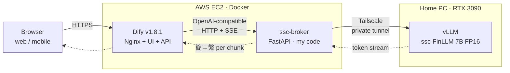

# Financial Education LLM Assistant

[](https://github.com/CrocoWilly/FinancialEducationLLMAssistant/actions/workflows/tests.yml)

A Traditional-Chinese financial Q&A assistant: a web/mobile chat UI on AWS, answering in real time from a 7B financial LLM running on a home GPU.

> **Status:** ran in September 2025 and was used by 8 people ([numbers below](#in-production-september-2025)). The GPU machine has since been retired, so the live deployment is offline; the demo video, the broker, and its tests remain.

## TL;DR

**Solo project.** I designed, deployed, and tested the whole pipeline. Dify (chat UI and orchestration), vLLM (inference) and the ssc-FinLLM model are off-the-shelf; **the FastAPI broker that connects them and the benchmark tooling are my code.**

- **Cloud-to-home streaming pipeline.** Dify on AWS EC2 → my broker → Tailscale → vLLM on a local RTX 3090, with tokens streamed end to end over SSE.
- **Tested on a real GPU.** I rented an RTX 3090, the GPU the app ran on, and simulated many users chatting at once. One GPU served **80 people at the same time with no errors**, and answers started appearing within about half a second. [Details ↓](#gpu-benchmark-rtx-3090)
- **Tuned the broker's limit with data.** The broker limits how many requests reach the GPU at once. The test showed the original limit of 16 was too strict: users waited in line while the GPU had room to spare. Raising it to 32 made the slowest answers finish 26–40% sooner.
- **Low-overhead broker.** At 50 concurrent streams it adds ≤ ~10 ms to time-to-first-token (p95), with 0 errors and no per-stream slowdown, while converting every chunk from Simplified to Traditional Chinese.
- **Found and fixed a concurrency bug by load testing.** The original semaphore logic let streams bypass the cap entirely and leaked slots on idle, dropping throughput from ~197 to 66 tok/s. I reproduced it with a mock upstream, fixed it, and verified the fix with the same test. [Details ↓](#case-study-a-concurrency-cap-that-didnt-cap)

## Demo

[](https://drive.google.com/file/d/13gUPVPvrnMjAFcjswvMSbEEROo9Srip6/view?usp=sharing)

Click the screenshot to watch the real-time demo ([short link](https://reurl.cc/EQx22R)).

## Architecture



| Component | Role | Source |
|---|---|---|
| Dify v1.8.1 | Chat UI, conversation handling, the chatflow (retrieval → LLM → answer); configured with the broker as an "OpenAI-API-compatible" model provider | [langgenius/dify@1.8.1](https://github.com/langgenius/dify/tree/1.8.1), standard Docker deployment |
| **ssc-broker** | Protocol adapter, 繁↔簡 conversion, concurrency control, timeouts, error mapping | **[`ssc-broker/`](ssc-broker/)** |
| vLLM | Serves the model over an OpenAI-compatible API with token streaming | [vllm-project/vllm](https://github.com/vllm-project/vllm) |
| ssc-FinLLM 7B | Chinese financial LLM (InternLM2 architecture, FP16) | [haidizym/ssc-FinLLM](https://github.com/haidizym/ssc-FinLLM) |

## Design decisions

**Why a broker instead of pointing Dify straight at vLLM?**
Dify and vLLM don't quite fit together. Dify probes the endpoint with `GET /v1/chat/completions` when you add a model, and vLLM answers 404. Dify may also send other model names (e.g. `gpt-4o-mini`) that vLLM doesn't serve. The broker answers the probe itself and forces the model name. It also gives me one place for language conversion and for protecting the GPU, without modifying either project.

**Why convert 繁→簡 on input and 簡→繁 on output?**
ssc-FinLLM is a Simplified-Chinese model, but the users read Traditional Chinese. Input is converted with OpenCC `t2s`; output uses `s2twp`, which also maps vocabulary to Taiwan usage (e.g. 软件 → 軟體), not just characters. Output is converted **per SSE chunk**, so streaming stays real-time instead of waiting for the full answer.

**Why cap concurrency in the broker when vLLM already batches requests?**
vLLM accepts every request and queues internally. On a single 24 GB consumer GPU, too many concurrent sequences compete for KV-cache memory and every user slows down. A semaphore in the broker (`BROKER_MAX_INFLIGHT`) bounds how much work reaches the GPU. Requests beyond the cap wait in a queue with a timeout and then get a fast `503` with `Retry-After`, instead of hanging.

The limit is 32. I chose it by testing three settings on the GPU ([details](#what-should-the-brokers-limit-be)):
- **16 was too strict.** Requests waited in line while the GPU still had free memory.
- **No limit was too loose.** Under heavy load the GPU ran out of memory, and vLLM had to pause answers and redo them, which slowed everyone down.
- **32 was the fastest of the three.**

**Why Tailscale between EC2 and the home PC?**
The GPU machine needs no public port or router configuration. Traffic goes through an encrypted WireGuard tunnel, and EC2 reaches the PC at a stable private address. Running the GPU at home avoids paying for a cloud GPU around the clock.

**Who can reach the GPU?**
The broker only needs to be reachable by Dify, which talks to it over the Docker network, so its port is published on `127.0.0.1` only. On top of that, `/v1/*` requires a shared API key (`Authorization: Bearer …`, compared with `hmac.compare_digest` to avoid timing leaks), checked before rate limiting and before a concurrency slot is taken, so unauthenticated traffic never queues for the GPU. `docker compose` refuses to start without a key.

**Timeouts and failure modes.**
Connect and read timeouts are separate. The read timeout applies *between chunks*, so a long but healthy stream isn't cut off, while a stalled one is. Errors map to distinct statuses: `502` when vLLM is unreachable, `504` on timeout, `503` when the queue is full, `429` when rate-limited, `401` without a valid key. If vLLM fails mid-stream, the client gets a final SSE error event. When a client disconnects, the slot is still released (verified by test).

## Chatflow and knowledge retrieval

The Dify app 「金融知識小幫手」 is a chatflow: **start → knowledge retrieval → LLM → answer**.

- **Knowledge:** three personal-finance course notes (introduction, time value of money, annuities), split into 262 chunks. Retrieval is Dify's *economy* mode, a keyword index without embeddings, returning the top 4 chunks.
- **LLM step:** ssc-FinLLM through the broker, temperature 0.7, max 512 tokens, with the retrieved chunks injected into the system prompt.
- **System prompt rules:** answer in Traditional Chinese, step by step; show the assumptions and steps for any calculation; if the retrieved excerpts don't support an answer, say 「資料不足」 and list what information is missing; no investment solicitation, return guarantees, or stock tips.

**What went wrong with vector search.** I first built a second knowledge base in *high-quality* mode with `text-embedding-3-large`. All three documents failed to index with `404 {"detail": "Not Found"}`. That body is FastAPI's default 404, which points to the cause: Dify's `OPENAI_API_BASE` was set to the broker, so the embedding calls most likely went to the broker, which only implements chat endpoints. I switched to the keyword-indexed knowledge base, which is what the app ran with. The fix for vector search would be to point embeddings at a real embedding endpoint, or add `/v1/embeddings` to the broker.

## Case study: a concurrency cap that didn't cap

**Symptom found in review.** The original broker released its semaphore slot with:

```python
finally:
    if sem.locked():   # only true when the count is exactly 0
        sem.release()
```

**Reproduction.** I wrote a mock vLLM ([`benchmark/mock_upstream.py`](benchmark/mock_upstream.py)) that streams at a fixed 60 tok/s and records how many requests it is serving at once. Because the upstream speed is fixed, any change in the numbers comes from the broker. Setup: cap = 4, ~1.2 s per request, a fresh broker and mock process for every cell, and non-stream cells repeated 3× with identical results.

| Clients | Before — stream<br/>peak in-flight | Before — non-stream<br/>peak / throughput | After — stream<br/>peak in-flight | After — non-stream<br/>peak / throughput |
|---|---|---|---|---|
| 4  | 4 | 4 / **66 tok/s** ⚠️ | 4 | 4 / 197 tok/s |
| 8  | **8** ❌ | 4 / 194 tok/s | 4 | 4 / 197 tok/s |
| 16 | **16** ❌ | 4 / 194 tok/s | 4 | 4 / 197 tok/s |

*With the cap working, throughput should be about 4 slots × 60 tok/s ≈ 197 tok/s.*

**Root cause: two opposite failures.**
- **Stream: the cap was never enforced.** The handler returns a `StreamingResponse` immediately, so the `finally` runs *before* streaming starts and releases the slot early. The generator then releases it again. Every client got through.
- **Non-stream: slots leaked when nobody was queued.** A slot was returned only if the count happened to be 0. When 4 requests finished together with no one waiting, 3 slots were lost and the broker dropped to one request at a time. Under constant overload it looked fine. In production, every lull in traffic would leak slots until the broker was permanently serialized.

**Lesson.** Peak in-flight alone looked healthy in the non-stream case. Only throughput exposed the leak.

**Fix.** Each request owns exactly one slot, wrapped in an idempotent `release()`, and the semaphore is an `asyncio.BoundedSemaphore`, so any future double release raises `ValueError` instead of silently raising the cap. Non-stream requests release it in `finally`. Streams release it when the generator finishes, with a background-task fallback in case the client disconnects before streaming starts. The same test now shows the peak stays at 4 and throughput at ~197 tok/s, and extra requests queue as expected.

**Regression tests.** Both failure modes are now pytest cases that run in CI (see [Testing](#testing)). Run against the original `broker.py`, they fail with `assert 6 == 2` (stream cap bypassed) and `assert 1 == 2` (slots leaked).

## In production (September 2025)

The app ran for two days in September 2025. These numbers come from Dify's database and the broker's log, saved before the server was shut down.

| | |
|---|---|
| People who asked questions | 8 (10 test accounts) |
| Conversations / answers | 20 / 61 |
| Most people using it at the same time | 2–3 |
| Requests through the broker | 75, all successful |
| Time to get a full answer | about 5 s (median) |

How these people used the app also shaped the GPU test below: they waited about 24 seconds between questions, and a typical answer was short (about 75 tokens).

**Dify counts tokens about twice too high.** I first reported ~61 tokens/s from Dify's logs. When I recounted with the model's own tokenizer, Dify's numbers turned out about 2× too high (a typical prompt: 727 by Dify's count, 377 actually). The speed measured on a real GPU is 52.9 tokens/s.

## Performance

**Broker overhead.** Measured with [`benchmark/bench.py`](benchmark/bench.py) against the mock upstream (60 tok/s, 200 ms TTFT), 256 tokens per request, cap 64, everything on one Apple M4 machine:

| Concurrent streams | Errors | TTFT p95: direct → via broker | Per-stream tok/s | Aggregate tok/s |
|---|---|---|---|---|
| 1  | 0 | 0.23 s → 0.23 s | 60.0 | 57 |
| 16 | 0 | 0.22 s → 0.22 s | 60.0 | 915 |
| 32 | 0 | 0.22 s → 0.23 s | 60.0 | 1,828 |
| 50 | 0 | 0.23 s → 0.24 s | 60.0 | 2,848 |

The broker is not the bottleneck. System capacity is bounded by GPU throughput.

### GPU benchmark (RTX 3090)

**In short:**
- **One RTX 3090 comfortably serves 80 people chatting at the same time.**
- **One person sees about 53 tokens/s.**
- **Letting the broker send up to 32 requests to the GPU at once works best.** The old limit of 16 was too strict, and no limit was worse too.

#### How I tested

I rented an RTX 3090, the same GPU the app used, and ran the model with the same settings as in production, with the broker in front.

A script ([`sessions.py`](benchmark/sessions.py)) plays many users at once. Each pretend user:
1. asks a question,
2. waits for the full answer,
3. pauses for about 24 seconds, like the real users did,
4. and asks again.

Each test runs for 3 minutes, with 10 to 300 users. To be safe, the test prompts are about twice as long as real ones, so real traffic should do a little better than the numbers here.

One script, [`gpu_run.sh`](benchmark/gpu_run.sh), runs the whole test. The raw results are in [`benchmark/results/`](benchmark/results/rtx3090-2026-11-10/).

**Terms used below**
- **Answer starts:** time until the first words appear.
- **Answer done:** time until the whole answer has arrived.
- **p95:** 95% of requests were at least this fast. It shows what the slower users experienced.

#### How many users can one GPU serve?

With the broker's limit at 32:

| Users chatting at once | Answer starts (p95) | Answer done (p95) | Errors |
|---|---|---|---|
| 50 | 0.4 s | 5.3 s | 0 |
| **80** | **0.5 s** | **7.0 s** | **0** |
| 150 | 7.9 s | 16.9 s | 0 |
| 300 | 39.7 s | 48.4 s | 0 |

Up to 80 users, answers start almost immediately. At 150, users wait several seconds before the answer starts. At 300, the GPU is overloaded.

#### What should the broker's limit be?

The broker limits how many requests it sends to the GPU at once. Extra requests wait in the broker until a slot frees up. I compared a limit of 16, a limit of 32, and no limit.

Too many requests at once is also a problem. The GPU keeps each answer in progress in its memory (the KV cache). When that memory runs out, vLLM has to pause some answers and redo them later, which slows everyone down.

Answer done (p95):

| Situation | Limit 16 | **Limit 32** | No limit |
|---|---|---|---|
| 150 users, normal answers | 22.8 s | **16.9 s** | 23.7 s, 20 answers paused and redone |
| 100 users, every answer 512 tokens long | 69.8 s, 5 requests rejected | **42.2 s** | 49.8 s, 101 answers paused and redone |

- **Limit 16 is too strict.** Requests waited in line while the GPU still had plenty of free memory: it never used more than 37%.
- **No limit is too loose.** The GPU's memory filled up, and answers had to be paused and redone.
- **Limit 32 works best.** Memory use peaked at 73%, nothing had to be redone, and the slowest answers finished sooner than with either other setting.

So I changed the broker's default limit from 16 to 32.

#### Speed when many requests run at once

Sending requests straight to vLLM, without the broker:

| Requests at once | 1 | 4 | 16 | 32 |
|---|---|---|---|---|
| Speed each user sees (tokens/s) | 53 | 41 | 22 | 13 |
| Total speed of the GPU (tokens/s) | 46 | 127 | 272 | 332 |

The more requests share the GPU, the slower each one is, but the GPU produces more in total.

One user's 53 tokens/s is the most this card can deliver. To produce each token, the GPU has to read the whole model (15.5 GB) from memory, and this card reads about 805 GB per second (805 ÷ 15.5 ≈ 52).

#### Other findings

- **The GPU spends most of its time reading prompts, not writing answers.** Each request sends a long prompt (instructions plus course notes) and gets a short answer back. vLLM can reuse work when prompts start with the same text. Right now the course notes come first and the fixed instructions last, so there is little to reuse. Moving the instructions to the front would help.
- **Converting to Simplified Chinese also saves work.** The broker converts questions to Simplified Chinese for the model. For this model, the same prompt is 14% shorter in Simplified.
- **I caught a mistake in my first test.** My first version sent nearly identical prompts every time. vLLM reused most of the work, and the results looked 2–3× better than reality. I noticed it in vLLM's logs, fixed the test, and reran everything. Only the fixed results are shown here.

#### Limits of this test

- The course notes in the test prompts are stand-in text of the same length, not the real notes.
- Each setting was run once. The differences between settings are much larger than the variation between runs.
- The production machine's vLLM version wasn't recorded. The test used vLLM 0.33.0.

### GPU memory: estimate vs measured

Before renting the GPU, I calculated from the model's config how much memory would be left for answers in progress (the KV cache): room for about 47–51k tokens. On the real card, vLLM reported 48.6–51.8k ([log](benchmark/results/rtx3090-2026-11-10/vllm_kv_cache.txt)), matching the estimate.

<details>
<summary>How the estimate works</summary>

All sizes in GiB (2³⁰ bytes).

| | | Source |
|---|---|---|
| Memory vLLM may use | 21.6 GiB | 90% of 24 GiB, vLLM's default (vLLM 0.33 uses 92% of the 23.56 GiB the driver reports: 21.68 GiB) |
| − model weights | 14.41 GiB | 15,475,417,088 bytes, `total_size` in [`pytorch_model.bin.index.json`](models/ssc-finllm-model/pytorch_model.bin.index.json) |
| − other runtime memory | ~1–1.5 GiB | rule of thumb |
| **= memory for answers in progress** | **~5.7–6.2 GiB** | |
| Memory per token | 128 KiB | 2 (K and V) × 32 layers × 8 KV heads × 128 dims × 2 bytes |
| **= tokens that fit** | **~47–51 k** | |

The per-token figure comes from [`config.json`](models/ssc-finllm-model/config.json): `num_hidden_layers` 32, `num_key_value_heads` 8 (grouped-query attention, so 8 K/V heads are shared by the 32 query heads), head size `hidden_size` 4096 ÷ `num_attention_heads` 32 = 128, and `torch_dtype` float16 = 2 bytes.

</details>

## Quickstart (no GPU needed)

Runs the broker against the mock upstream and load-tests it:

```bash
python -m venv .venv && source .venv/bin/activate
pip install -r ssc-broker/requirements.txt -r benchmark/requirements.txt

uvicorn mock_upstream:app --app-dir benchmark --port 8000 --log-level warning &
UPSTREAM_LLM_BASE=http://127.0.0.1:8000/v1 BROKER_MAX_INFLIGHT=4 \
    uvicorn broker:app --app-dir ssc-broker --port 8080 --log-level warning &
sleep 3

python benchmark/bench.py --base-url http://localhost:8080/v1 --concurrency 1,4,8 --max-tokens 60
curl localhost:8000/stats      # peak_inflight stays at 4
kill %1 %2
```

The output is streamed in Traditional Chinese, converted by the broker from the mock's Simplified text. For production deployment and configuration, see [`ssc-broker/README.md`](ssc-broker/README.md). For GPU benchmarking, see [`benchmark/README.md`](benchmark/README.md).

## Testing

```bash
pip install -r requirements-dev.txt
pytest -v
```

31 tests in [`tests/test_broker.py`](tests/test_broker.py) run in about 15 s and need no GPU. GitHub Actions runs them on every push and pull request. Each test starts a real broker and mock vLLM on free local ports and talks to them over HTTP, so streaming, timeouts and disconnects go through the same code paths as in production. The logging tests go one step further and launch `uvicorn` as a separate process, because a missing log handler only shows up there.

| Area | What is checked |
|---|---|
| Protocol | Dify probe answered locally, model name forced, `/health` |
| Language | input 繁→簡, output 簡→繁 (stream and non-stream) |
| Concurrency | cap never exceeded; slots returned after normal completion, upstream errors and client disconnects; over-release raises instead of silently raising the cap; `503` when the queue is full |
| Failures | `502` unreachable upstream, upstream status passed through, `504` timeout, SSE error event on mid-stream timeout |
| Rate limit | `429` inside the window |
| Auth | `401` without / with a wrong key on `/v1/*`; correct key accepted; `/health` and Dify probe stay open; rejected requests never reach the GPU or take a slot |
| Logging | request log lines and the missing-key warning actually appear in uvicorn's output |

To check that the tests actually catch bugs, I ran them against the original `broker.py` (19 of 31 fail, each matching a known bug or a feature it lacked). I also deliberately broke each slot-release path, the API-key check and the log handler in the fixed broker; every one of those changes is caught by at least one test.

## Limitations & next steps

- **The broker's limit counts requests, not their size.** 32 suits this GPU and these prompts. A different GPU or much longer prompts would need a new value. A smarter limit would count tokens against the GPU's free memory instead.
- **The prompt order makes it hard for vLLM to reuse work.** The fixed instructions come after the course notes. Moving them to the front would let vLLM reuse them for every request.
- **Retries:** failed upstream calls are not retried. A retry is only safe before streaming starts.
- **Rate limiting:** the broker only sees Dify's IP, so its per-IP limit would throttle all users together; it is off by default. Per-user limits should be set in Nginx (which sees client IPs; its config lives in the Dify deployment on EC2, not in this repo) or in Dify. The limiter's per-IP table is also in-memory and never pruned.
- **Multiple workers / instances:** the concurrency cap and rate limit are per process, so N uvicorn workers allow N × `BROKER_MAX_INFLIGHT`. A shared cap would need Redis or similar.
- **Reproducibility:** Dify ran as the stock 1.8.1 Docker deployment with two changes: `OPENAI_API_BASE=http://broker:8080` in `.env`, and `extra_hosts: host.docker.internal:host-gateway` on the `api`, `worker` and `worker_beat` services. vLLM ran with `--dtype float16 --max-model-len 4096 --trust-remote-code` and default memory settings; the full command is in [`benchmark/README.md`](benchmark/README.md), and the benchmark's versions are in [`env.txt`](benchmark/results/rtx3090-2026-11-10/env.txt).

## Repository structure

```
ssc-broker/          FastAPI broker (my code): broker.py, Dockerfile, docker-compose.yml
benchmark/           bench.py load tester, sessions.py chat-user simulator, mock_upstream.py fake vLLM,
                     gpu_run.sh one-shot GPU benchmark, results/ raw output of the RTX 3090 run
tests/               pytest suite for the broker (runs in CI)
.github/workflows/   GitHub Actions: run pytest on every push / PR
models/ssc-finllm-model/   model config & tokenizer files (weights not committed)
doc_image/           demo screenshot & video
```

## Tech stack

Python · FastAPI · httpx · asyncio · SSE · OpenCC · pytest · GitHub Actions · Docker · AWS EC2 (Ubuntu 22.04) · Tailscale · vLLM · Dify

## References

- [Dify v1.8.1](https://github.com/langgenius/dify/tree/1.8.1) · [docs](https://docs.dify.ai/)
- [vLLM](https://github.com/vllm-project/vllm)
- [ssc-FinLLM](https://github.com/haidizym/ssc-FinLLM)
- [FastAPI](https://fastapi.tiangolo.com/) · [OpenCC](https://github.com/BYVoid/OpenCC) · [Tailscale](https://tailscale.com/)
